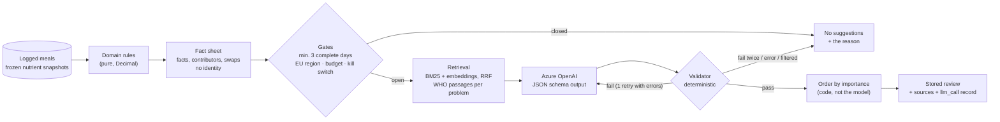

# Food Coach

A food journal with a weekly AI coach that is not allowed to make things up. The backend computes every
number; the model words suggestions about facts it is handed, grounds its advice in passages retrieved
from WHO guidance, and a deterministic validator rejects any output that cites a number, product, source
or claim it was not given. There is no canned fallback text: a week gets AI suggestions that passed the
checker, or none.

FastAPI · PostgreSQL · React PWA · Azure OpenAI · Azure Container Apps (Bicep)

**[Try the coach playground](https://foodcoach-demo.ashyisland-fb3eded8.italynorth.azurecontainerapps.io)**: pick a
sample week, see the facts the backend computed, and get a live AI review with its WHO sources and the
checker's verdict. The page opens on a stored review; live calls are capped per day, and past the cap
the stored review is shown, labelled. Any card can be flagged as wrong, with a reason, and the flags are
listed on the page.

> **Status.** Built for one user (the API accepts a single Entra account). The application, the
> infrastructure code and the deploy pipeline are complete and run locally. The full app's Azure go-live
> described in [docs/deploy.md](docs/deploy.md) has not been executed; the public instance is the coach
> playground above ([`backend/app/demo.py`](backend/app/demo.py)), which runs the product's own retrieval,
> prompt, validator and ordering on synthetic weeks, with no database or login.

## The problem

Food apps fail in two ways. They treat missing data as zero, so "you are within your salt limit" can be
wrong simply because a product had no salt value. And when an LLM is added on top, it produces fluent
advice with invented figures, products that are not in the catalogue, and health claims nobody checked.

Food Coach is built on one rule: **the system makes only the claims its data can support, and says which
data a claim rests on.** Unknown is never 0. A limit comparison is shown only when the missing data could
not reverse it. The same rule is applied to the model.

## How the weekly coach works



1. **Fact sheet.** [`coach/factsheet.py`](backend/app/coach/factsheet.py) runs the pure domain rules over
   the week and produces one anonymous document: facts, the foods that drove each fact with their share,
   and catalogue swaps. Internal ids are stripped before it is sent. Product names are the only free text.
2. **Gates before any call.** No call is made with fewer than three complete days, from a non-EU model
   deployment (unless explicitly allowed), over the monthly budget, or when the kill switch is off.
3. **Retrieval.** [`coach/knowledge.py`](backend/app/coach/knowledge.py) holds 470 sentence-aligned
   excerpts of seven public WHO documents ([sources and licence](backend/knowledge/guidelines/SOURCES.md)).
   For each problem in the week it builds a query from the rule and the foods behind it and ranks the
   excerpts with BM25 and embeddings fused by reciprocal rank, in memory. Two rules narrow what the model
   may see: only excerpts without medical wording (252 of 470), and nothing at all for a sugars or salt
   fact whose guideline card the user has not verified. If the embedding call fails, ranking falls back
   to BM25.
4. **Structured call.** One module, [`coach/llm.py`](backend/app/coach/llm.py), is allowed to call the
   model. The prompt ([`v7`](backend/prompts/coach/v7.md)) asks for one suggestion per problem: what the
   record shows, the largest source with its share, and one concrete action, taken from a retrieved
   passage when one fits the food.
5. **Validation.** [`domain/coach_validator.py`](backend/app/domain/coach_validator.py) checks each
   suggestion only against the facts, swaps and passages it cites: schema, references, every number,
   every product name, forbidden wording ("you ate", disease words, uncited guideline claims, cooking
   additions nobody left undeclared, a nutrient the week has no fact about) and claim direction. Advice
   may not treat energy that is in line with the goal as a problem, a swap on offer for the named
   food must be used, a food called the largest source must be the one ranked first, and a food named
   in the title must be the one the body is about. A cited passage must belong to a cited fact; one
   the text does not draw on is dropped, and a second model call withdraws any citation the passage
   does not actually support. Slips with one right answer are repaired first; a failed output is
   retried once with the validator errors.
6. **Ordering.** The model words the advice; code decides the order (energy working against the goal,
   then the limit exceeded on the most days) and drops the "keep going" card once two problems are shown.
7. **No static fallback.** If both attempts fail, Azure blocks the request, or a gate is closed, the user
   is told that no AI suggestions were produced and why. Nothing pre-written is shown in their place.
8. **Concurrency and cost.** [`coach/service.py`](backend/app/coach/service.py) claims the week under a
   Postgres advisory lock and commits a placeholder, calls the model outside any transaction, then settles
   the reserved budget with the actual cost. Concurrent requests produce exactly one model call.

## Evaluation

### Current code, measured 24 Nov 2026

One live run of prompt v7 with the current validator, on the `gpt-4.1-mini` deployment the public
playground uses, over every split. Each figure below comes from a summary file in
[`docs/evals/runs-2026-11-24/`](docs/evals/runs-2026-11-24/), next to the per-week outputs it was computed
from (`<split>.jsonl`). Reproduce with `python -m app.coach.eval --split <split> --source llm`.

| | single-food (`test`) | realistic (`test_mixed`) | random (`test_random`) |
|---|---:|---:|---:|
| Held-out weeks | 15 | 6 | 20 |
| Weeks with a checked review / weeks sent to the model | 13 / 13 | 6 / 6 | 20 / 20 |
| Hard failures (no review after the retry) | 0 | 0 | 0 |
| First-try pass rate | 0.85 | 0.50 | 0.80 |
| Problem comes first | 1.00 | 1.00 | 0.95 |
| Largest source named | 1.00 | 1.00 | 1.00 |
| Advice citing a guideline passage | 0.55 | 0.38 | 0.09 |
| Cost per review | €0.0023 | €0.0033 | €0.0030 |
| Latency p95 | 3.3 s | 4.8 s | 5.0 s |

Two `test` weeks are not sent to the model by design: one has too little data, and the prompt-injection
week is blocked by Azure's content filter. The validator rejected all 20 seeded bad outputs. Across the
41 held-out weeks, 30 of the 39 sent to the model passed the checker first try, and the other 9 passed on
the retry. The dev splits (`dev`, `dev_mixed`, `dev_random`) are in the same folder: 0 hard failures,
first-try 0.90 / 0.67 / 0.70. On the 20 labelled citation pairs the second-call check got 19 right: it
kept one unsupported passage (`knowledge.json`). Retrieval on the 12 labelled queries reproduced the
table below exactly.

### How the design got here

The tables in this section record the development history. Their run files were not kept, so they can
be read but not re-checked; the figures above replace them where they differ.

Everything below is measured on synthetic fact sheets with live calls to `gpt-4.1-mini` in the Azure EU
data zone, one run per cell. Two dev sets are used: 25 single-food weeks across 14 scenarios (including
prompt injection in a product name), and 6 realistic weeks with several foods a day, competing problems
and a dish with undeclared cooking additions. Each has a held-out counterpart (`test`, `test_mixed`).

**What each change bought** (25 single-food weeks / 6 realistic weeks):

| | v4 prompt | v5: one action per problem | v6: + retrieved WHO passages |
|---|---:|---:|---:|
| First-try pass rate | 0.90 / 0.33 | 0.95 / 0.83 | 1.00 / 0.83 |
| Hard failures after validation | 0 / 0 | 0 / 0 | 0 / 0 |
| Share of cards that only say "keep going" | 0.62 / 0.47 | 0.22 / 0.30 | 0.32 / 0.20 |
| Problem comes first | 0.94 / 0.83 | 1.00 / 1.00 | 1.00 / 1.00 |
| Largest source named | 0.88 / 0.67 | 0.94 / 1.00 | 1.00 / 0.83 |
| Advice citing a guideline passage | n/a | n/a | 0.74 / 0.62 |
| Cost per review | €0.0012 / €0.0021 | €0.0016 / €0.0019 | €0.0019 / €0.0023 |

The realistic weeks are what exposed v4: every one of the original weeks logged a single product, so
shares were always 100% and nothing had to be prioritised. On mixed weeks v4 passed the checker first try
on 2 of 6 and once blamed the second-largest sugar source. The usefulness rows are deterministic proxies
computed by the eval runner ([`coach/eval.py`](backend/app/coach/eval.py)), not human ratings.

**Retrieval quality** on 12 labelled queries
([`evals/knowledge/labels.json`](backend/evals/knowledge/labels.json)), over the excerpts the coach may use:

| Ranking | recall@3 | MRR |
|---|---:|---:|
| BM25 | 0.83 | 0.76 |
| Embeddings (`text-embedding-3-small`, 256 dimensions) | 1.00 | 0.92 |
| Hybrid (reciprocal rank fusion) | 0.92 | 0.89 |

Embeddings alone beat the hybrid on this set, by one query. The hybrid is kept because BM25 is the
fallback when the embedding call fails, and 12 queries written by the author are too few to settle it.

**What retrieval costs.** With passages switched off (`--no-knowledge`), the same prompt gave 0.86 / 0.83
first-try pass and €0.0021 / €0.0022 per review. An earlier build that rejected a suggestion for listing a
passage it did not use fell to 0.71 on the 25 weeks; dropping the unused citation instead of rejecting
brought it back to 1.00.

**Held-out run of v6** (one live run, thresholds frozen before v4):

| Criterion | Threshold | 15 test weeks | 6 realistic test weeks |
|---|---:|---:|---:|
| Hard failures after validation | 0 | 0 | 0 |
| Validator catch rate on seeded bad outputs | 100% | 100% | 100% |
| First-try pass rate | ≥ 90% | 100% | 100% |
| Cost per review | ≤ €0.05 | €0.0018 | €0.0020 |
| Latency p95 | ≤ 15 s | 1.8 s | 1.9 s |
| Problem comes first / largest source named | (reported) | 1.00 / 1.00 | 0.83 / 0.67 |
| Advice citing a guideline passage | (reported) | 0.67 | 0.38 |

The rubric criterion has not been scored for v6, so this is not a completed gate. Passing the automated
thresholds was also not the same as being right: reading the realistic held-out outputs showed three
mistakes the checker let through (advice to add energy to someone trying to lose weight, a claim about
protein in a week with no protein fact, and an available swap ignored). Each is now a validator rule,
written from the rule definitions and tested on dev weeks, not tuned on the held-out ones; prompt v7
states them. With the stricter rules, first-try pass on dev is 0.90 / 0.67 with no review lost: every
rejected first attempt passed on the retry. v7 has not been run on the held-out weeks.

**Unseen random weeks** (current code, prompt v7). The hand-designed weeks above are few and the prompt
was tuned around them, so 20 dev and 20 held-out weeks were generated with menus, portions, swaps, goals
and weight trends drawn at random. Held-out weeks, three live runs:

| | Before repairs (3 runs) | After repairs (3 runs) |
|---|---:|---:|
| Hard failures after validation | 0, 0, 0 | 0, 0, 0 |
| First-try pass rate | 0.50, 0.45, 0.40 | 0.85, 0.90, 0.95 |
| Weeks left with no review (of 20) | 0, 2, 4 | 0, 0, 0 |
| Problem comes first | 0.95, 0.94, 0.87 | 0.95, 0.95, 0.95 |
| Largest source named | 1.00 | 1.00 |
| Advice citing a guideline passage | 0.06, 0.12, 0.15 | 0.09, 0.04, 0.13 |
| Cost per review | about €0.0039 | about €0.0027 |

Two things this showed. First, on weeks nobody designed, the prompt that scored 1.00 first-try on its own
dev set scored 0.40 to 0.50, and up to 4 weeks in 20 got no review. Most rejections were slips with a
single right answer (a title a few characters too long, a card citing a swap but not marked as one,
advice about energy already in line with the goal), so [`service.repair`](backend/app/coach/service.py)
now fixes those before validation instead of spending a retry. The fixes were chosen from the dev weeks'
errors; the held-out tallies had been seen and showed the same categories. Second, most citations were
decoration: see the next paragraph.

**Are the citations true?** Word overlap cannot tell whether a passage supports the advice, so a second
model call now checks each cited passage and withdraws the citation when it does not
([`knowledge.drop_unsupported`](backend/app/coach/knowledge.py)); the advice stays. On 20 labelled pairs
([`evals/knowledge/faithfulness.json`](backend/evals/knowledge/faithfulness.json): 10 supported, 10 not,
including contradictions and wrong-topic passages) the check got 20 right (19 in the 24 Nov re-run). Applied to the coach, it cut
advice citing a passage from about 0.65 to about 0.10: the model was usually giving a plain action
("have it on fewer days") and attaching a passage that says nothing of the sort. Retrieval therefore
adds a verified source to roughly one suggestion in ten today, which is the honest size of its
contribution. These runs used the non-EU deployment of the same model for its higher rate limit; the
weeks are synthetic.

**The original release gate** was passed by prompt v4, with thresholds
[fixed before the test split was run](docs/evals/coach-gate-frozen.md):

| Criterion | Threshold | v4 actual |
|---|---:|---:|
| Hard failures after validation | 0 | 0 |
| Validator catch rate on seeded bad outputs | 100% | 100% |
| First-try pass rate | ≥ 90% | 100% |
| Mean rubric score, LLM minus fixed-sentence baseline (1–5 scale) | ≥ 0.5 | 1.08 |
| Cost per review | ≤ €0.05 | €0.0012 |
| Latency p95 | ≤ 15 s | 2.4 s |

Full report and method: [docs/evals/coach-gate.md](docs/evals/coach-gate.md). **No later prompt has completed
this gate.** The fixed-sentence generator the rubric compares against
([`domain/coach_templates.py`](backend/app/domain/coach_templates.py)) is now an evaluation baseline only;
the product never shows it.

Limits: the rubric was scored by two AI raters with the author settling disagreements; all data is
synthetic; the dev figures are single runs at temperature 0.3; and a paraphrase of a passage cannot be
proven faithful: it is checked by a second model call, which was itself measured on only 20 pairs. CI replays recorded model responses on every push, so
a validator change that breaks them fails the build without a paid call.

## Architecture

```
backend/app/
  api/        HTTP routes, Entra JWT validation
  services/   use cases and transactions (logging, saved meals, search, privacy)
  domain/     pure rules: quantities, targets, weekly claims, swaps, coach validator
  coach/      fact sheet, guideline retrieval, LLM client, budget, service, eval runner
  db/         SQLAlchemy Core tables, catalogue queries, least-privilege app role
  importers/  Ciqual, Open Food Facts, supermarket and curated catalogue data
backend/migrations/   Alembic
backend/knowledge/    WHO guideline excerpts and their embeddings
backend/scripts/      backup, restore, retention check, smoke test, dev auth, corpus build
web/                  React 19 + TypeScript PWA (Vite, TanStack Query, MSAL)
infra/                Bicep: network, Postgres, API, jobs, alerts
```

Design choices worth knowing:

- **Decimal everywhere.** Nutrient and quantity maths never use float; unknown values are carried as
  unknown through every calculation.
- **Frozen snapshots.** A logged item stores the nutrient values it was logged with, so later catalogue
  edits do not rewrite history.
- **Idempotent logging.** Adding an item to a meal requires an `Idempotency-Key`, so a retried request
  on a bad mobile connection does not log the food twice.
- **Deletion that survives a restore.** `DELETE /me/data` bumps a per-user data generation and appends to
  a ledger kept outside the database. Stale writes are rejected with 409, and the restore script replays
  the ledger so a backup cannot bring deleted data back.
- **Auth.** Entra ID access tokens checked for issuer, audience, tenant, scope and one allowed object id.
  Local development uses a JWKS server that refuses to start outside dev mode.

## Infrastructure and operations

Defined in [`infra/`](infra/) and described in [docs/deploy.md](docs/deploy.md):

- Azure Container Apps for the API, PostgreSQL Flexible Server inside a private VNet, Key Vault, and
  managed identities (one for the API, one for operations jobs).
- Container Apps jobs for migrations, catalogue import, a daily backup, restore, and a weekly
  backup-retention check.
- Alerts on failed jobs, no successful backup in 26 hours, retention breaches, HTTP 5xx bursts and
  database storage, plus a cost budget.
- Deploy workflow: GitHub OIDC (no stored cloud secret), images referenced by digest, and a manual
  rollback input that redeploys a previous digest.
- CI: backend lint and tests against Postgres 16, the coach eval gate in replay mode, web tests, typecheck,
  lint and build, a Docker image build, and a Bicep build when `infra/` changes.

## Run it locally

Requirements: Python 3.12+, Node 20+, Docker.

```bash
docker compose up -d db
cd backend
python -m venv .venv && .venv/Scripts/activate      # Linux/macOS: source .venv/bin/activate
pip install -e ".[dev]"
python -m alembic upgrade head
```

The API also needs the catalogue import, a local token issuer and a few environment variables; the web app
needs a dev token. The full sequence is in [docs/dev-setup.md](docs/dev-setup.md).

Run the coach evaluation offline, from recorded responses:

```bash
cd backend
python -m app.coach.eval --split test --source llm --replay
```

## Limitations

- Single user by design. Multi-tenancy would need per-user authorisation beyond the one allowed account.
- The full app is not deployed (the go-live checks in the runbook are open); only the coach playground
  is public.
- No distributed tracing or metrics export. Each model call is recorded in the database (tokens, cost,
  latency, outcome), and Azure alerts cover the platform, but there is no OpenTelemetry instrumentation.
- The validator's wording and direction checks are pattern based. They are tuned to fail closed, so a
  correct suggestion can be rejected; a week whose retry also fails gets no review.
- The catalogue targets food sold in France.
- With no static fallback, a week whose request Azure blocks (for example a product name that looks
  like a prompt injection) gets no review, only the reason.
- The guideline corpus is WHO-only and has little practical advice on protein.

## Documentation

- Coach evaluation: [`docs/evals/`](docs/evals/), fixtures in [`backend/evals/coach/`](backend/evals/coach/)
- Deployment and operations: [docs/deploy.md](docs/deploy.md)
- Azure OpenAI setup: [docs/setup-azure-openai.md](docs/setup-azure-openai.md)
- Guideline corpus sources and licence: [`backend/knowledge/guidelines/SOURCES.md`](backend/knowledge/guidelines/SOURCES.md)
- Catalogue data sources and licences: [`backend/catalogue_data/SOURCES.md`](backend/catalogue_data/SOURCES.md)

## License

The code is under the [MIT License](LICENSE). The files in `backend/catalogue_data/` are third-party data
and keep their own terms: the supermarket snapshot is Open Food Facts data under the
[Open Database License](https://opendatacommons.org/licenses/odbl/), and the other sources are listed in
[`SOURCES.md`](backend/catalogue_data/SOURCES.md) and
[`SUPERMARKET.md`](backend/catalogue_data/SUPERMARKET.md).
